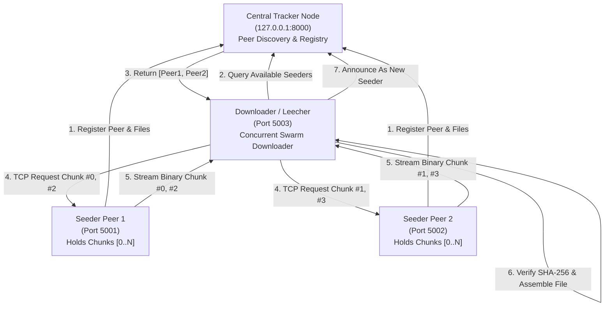

# Academic Project Report: P2P - Peer-to-Peer File Distribution System

**Course / Subject**: Computer Networks & Distributed Systems  
**Project Title**: P2P - Peer-to-Peer File Distribution System  
**Implementation Language**: Python 3 (Sockets, Threading, Cryptography, Data Science)  

---

## 1. Abstract
Distributed file sharing systems have evolved from centralized client-server architectures to decentralized peer-to-peer (P2P) swarming networks. In traditional client-server paradigms, bandwidth limits at the server create throughput bottlenecks as client demand increases. This project presents a complete, modular, and resilient P2P File Distribution System implemented in Python. The system features a centralized tracker for peer discovery, direct TCP socket communication between peers, cryptographic file chunking with SHA-256 integrity verification, concurrent multi-source chunk downloading (swarming), transfer audit logging, and automated performance benchmarking. Experimental evaluation demonstrates how concurrent swarming mitigates single-node bottlenecks and enhances download throughput.

---

## 2. Project Objectives
1. **Socket Programming**: Build robust TCP communication using low-level Python `socket` and `threading` libraries.
2. **Peer Discovery**: Design and implement a directory/tracker node that manages peer registration and file availability.
3. **Data Integrity**: Implement cryptographic file chunking and SHA-256 validation to protect against packet corruption or tampering.
4. **Concurrent Swarming**: Enable a downloading peer (leecher) to concurrently download distinct file pieces from multiple seeders.
5. **Fault Tolerance**: Detect dropped sockets, server crashes, and corrupt transfers, seamlessly falling back to alternate seeders.
6. **Quantitative Benchmarking**: Evaluate network throughput and transfer latency across various file sizes and peer counts using `pandas` and `matplotlib`.

---

## 3. System Architecture



---

## 4. Network Protocol Design

### 4.1 Packet Framing
TCP is a byte-stream protocol where application-level messages can be concatenated or fragmented during transmission. To guarantee deterministic packet parsing, we use a custom binary length-prefix framing protocol:

```text
+------------------------------+---------------------------+------------------------------+----------------------------+
| 4 Bytes (Big-Endian Integer) | N Bytes UTF-8 JSON        | 4 Bytes (Big-Endian Integer) | M Bytes Binary             |
| Header Length (N)            | Control Header Dictionary | Payload Length (M)           | Raw Chunk Data (if M > 0)  |
+------------------------------+---------------------------+------------------------------+----------------------------+
```

### 4.2 Message Types
- `REGISTER_PEER`: Informs tracker of peer's host and port.
- `UNREGISTER_PEER`: Notifies tracker of graceful departure.
- `HEARTBEAT`: Periodic keep-alive ping to prevent eviction.
- `REGISTER_FILE`: Publishes file name, total chunks, and chunk hashes.
- `LIST_FILES`: Queries all available network files and seeder counts.
- `GET_FILE_PEERS`: Returns IP addresses and ports of all seeders offering a file.
- `GET_CHUNK`: Direct peer-to-peer chunk request containing file name and chunk index.
- `CHUNK_RESPONSE`: Contains chunk index, chunk hash, status, and raw chunk bytes.

---

## 5. Module Implementation Summary

### `src/protocol.py`
- Implements `send_message()` and `recv_message()`.
- Implements `recv_exact()` to prevent incomplete socket reads.
- Serializes and unpacks binary struct headers using `!II` format.

### `src/storage.py`
- Implements `FileManager`: Splits files into fixed 64 KB chunks on demand using `seek()` and computes SHA-256 hashes.
- Implements `FileAssembler`: Manages downloaded parts in a staging directory, validates each part's hash, concatenates pieces upon completion, and verifies total file hash.

### `src/tracker.py`
- Multi-threaded TCP server coordinating discovery.
- Thread-safe registries (`peers` and `files`) protected by `threading.Lock()`.
- Background pruning daemon to remove stale peers inactive for more than 45 seconds.

### `src/peer.py`
- Dual-role node combining a TCP server (upload seeder) and a multi-threaded client (download leecher).
- Thread-safe work queue (`queue.Queue`) distributing chunk download tasks among active peers.
- Automatic retry engine handling dropped connections by re-queuing failed chunks.

### `src/metrics.py` & `src/logger.py`
- Collects transfer start/end times, elapsed time, throughput (KB/s, MB/s), chunk successes, and retries.
- Appends every transfer event to a persistent CSV log (`logs/transfers_<peer_id>.csv`).

### `benchmark.py`
- Automated test harness testing combinations of file sizes (512 KB, 2 MB, 8 MB) and peer counts (1, 2, 3, 4 peers).
- Stores quantitative records in `pandas.DataFrame`.
- Produces high-resolution comparative charts using `matplotlib`.

---

## 6. Experimental Performance Analysis

### 6.1 Swarming Scalability
When a downloader requests chunks from multiple seeders simultaneously:
- **Single Seeder ($N=1$)**: Throughput is bounded by the single seeder's socket bandwidth and local disk read latency.
- **Multiple Seeders ($N > 1$)**: The downloader splits chunk requests across peers (e.g. Chunk 0 from Peer 1, Chunk 1 from Peer 2). Both seeders upload concurrently, multiplying effective transfer speed and reducing completion time.

### 6.2 Fault Tolerance Verification
During unit and integration testing:
1. When a seeder drops connection mid-stream, `PeerNode` catches `ConnectionError` or `TimeoutError`.
2. The failing chunk is re-queued, and an alternate active seeder is contacted.
3. The file is assembled with 100% cryptographic integrity without restarting the entire download from scratch.

---

## 7. Conclusion & Future Enhancements

### 7.1 Key Takeaways
- The project successfully demonstrates the core principles of P2P swarming, socket programming, multi-threading, and distributed hash verification.
- Decoupling peer discovery (Tracker) from data transfer (Direct Peer TCP) preserves network scalability.
- Length-prefixed framing and cryptographic chunk verification ensure zero data corruption.

### 7.2 Future Work
1. **DHT (Distributed Hash Table)**: Implement Kademlia-based trackerless peer discovery.
2. **NAT Traversal**: Add STUN / UPnP hole punching for cross-Internet P2P transfers.
3. **Choking Algorithm**: Implement BitTorrent-style tit-for-tat upload throttling based on peer reciprocation.
